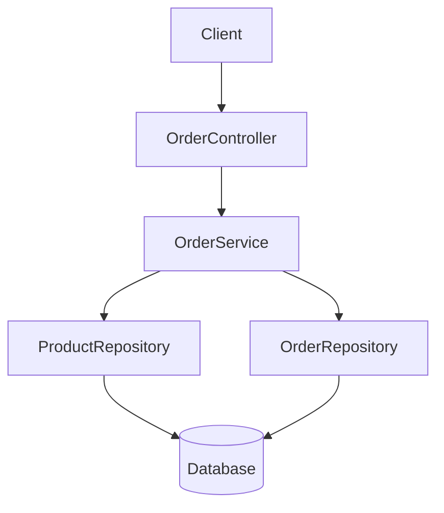
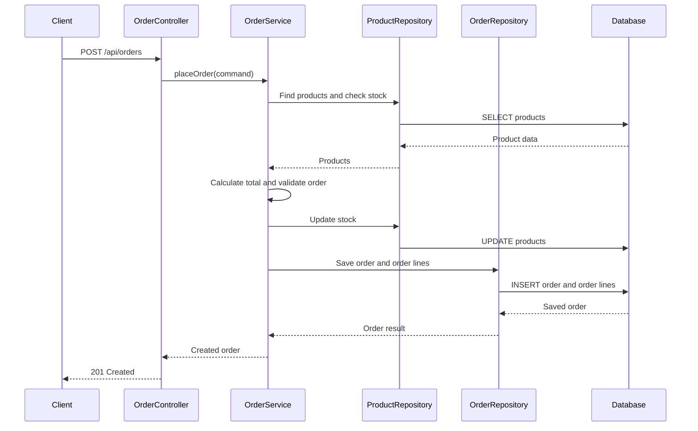

# Software Engineering Team Project

## 1. Component and Package Diagram

The application follows a layered architecture. Each layer has a specific responsibility, making the system easier to maintain, test, and extend.

### Package responsibilities

| Package / Component | Responsibility |
|---|---|
| Controller | Receives HTTP requests, validates input, and returns HTTP responses. |
| Service | Implements business logic and manages transactions. |
| Repository | Handles database access and persistence. |
| Domain / Model | Represents entities such as orders, order lines, and products. |
| Configuration | Contains application and database configuration. |

## 2. Place Order Request Flow

When a customer places an order, the request passes through the following layers:

1. **Client:** Sends a `POST /api/orders` request containing the order details.
2. **OrderController:** Receives the request, validates the input, and calls the order service.
3. **OrderService:** Starts the business operation and checks whether the requested products and quantities are valid.
4. **ProductRepository:** Retrieves the products and their current prices from the database.
5. **OrderService:** Calculates the order subtotal, tax, and total amount. It also checks and updates product stock.
6. **OrderRepository:** Saves the order and its order lines.
7. **OrderController:** Returns an HTTP `201 Created` response containing the created order.

The request flow can be represented as:

## 3. Transaction Boundary

The transaction boundary is located in the service layer, specifically in the order placement method of `OrderService`.

The method is annotated with `@Transactional`, which ensures that all database operations required to place an order are executed as one transaction. These operations include checking and updating product stock and saving the order and its order lines.

If all operations succeed, the transaction commits. If an operation fails and an exception causes a rollback, the transaction is rolled back so that partial changes are not permanently saved.

The transaction belongs in the service layer because placing an order involves multiple repositories and business operations that must succeed or fail together. Keeping the transaction at this level protects data consistency and prevents situations such as stock being reduced without an order being created.

## 4. Summary

The layered architecture separates HTTP handling, business logic, and database access. The service layer coordinates the complete order placement process and manages the transaction, while the repositories handle persistence. This separation improves maintainability, testability, and reliability.
