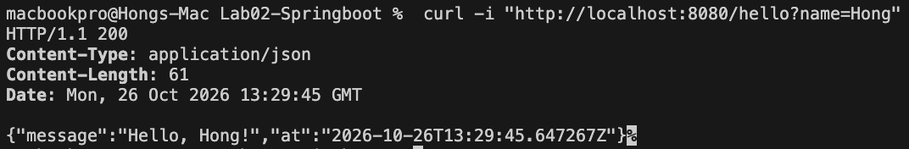
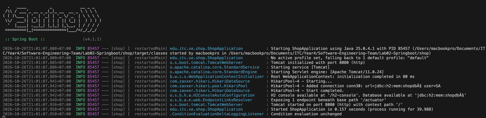
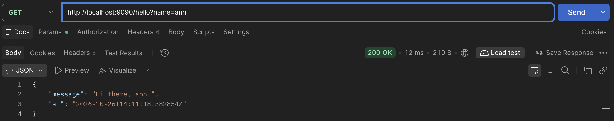
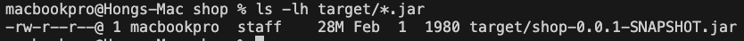
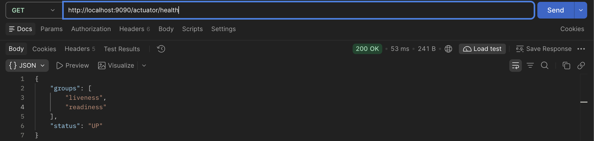
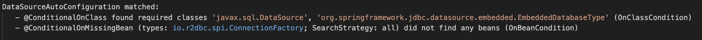
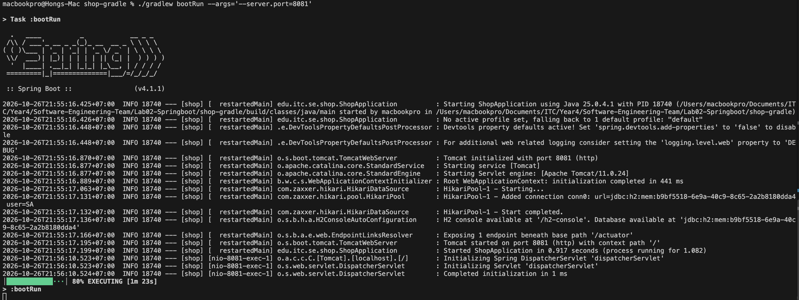
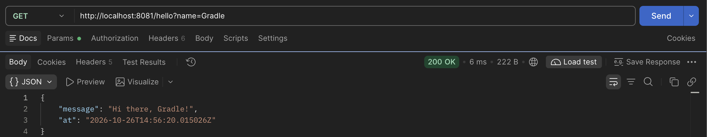

# Lab-02 · Spring Framework

Spring Boot 4.1.1 · Java 25 · Maven wrapper `./mvnw`

## Task 1 · Bootstrapping with Maven and Spring Boot

### 1. The `pom.xml`

```xml
<parent>
    <groupId>org.springframework.boot</groupId>
    <artifactId>spring-boot-starter-parent</artifactId>
    <version>4.1.1</version>
</parent>
```

**What does the `<parent>` give us?**
The project inherits from `spring-boot-starter-parent`. It brings:

- **Dependency management**: it imports `spring-boot-dependencies`, a list of about 1 000 libraries (Spring Framework, Tomcat, Jackson, H2, HikariCP, JUnit, Mockito…) with versions that were tested together.
- **Plugin management**: versions and settings for the compiler, surefire, jar and `spring-boot-maven-plugin`.
- **Defaults**: `java.version` (25) for the compiler, UTF-8 encoding, and the `-parameters` flag so Spring can read parameter names such as `name` in `hello(String name)`.

**Why do the starters have no `<version>`?**
Maven takes each version from the dependency management inherited from the parent. One number, the Boot version 4.1.1 in `<parent>`, decides the versions of all libraries, so they always fit together.

**What does `spring-boot-maven-plugin` do at `package` time?**
Its `repackage` goal runs after the normal `jar` step and rebuilds the jar as an executable **fat jar**:

- our classes go to `BOOT-INF/classes/`
- every runtime library jar goes, unchanged, to `BOOT-INF/lib/`
- the Spring Boot launcher classes are put at the root, and `MANIFEST.MF` gets `Main-Class: org.springframework.boot.loader.launch.JarLauncher` and `Start-Class: edu.itc.shop.ShopApplication`

So `java -jar` starts the launcher, which loads the nested jars and then calls our `main` method.

**`./mvnw dependency:tree` (first level)**

```
[INFO] edu.itc.se:shop:jar:0.0.1-SNAPSHOT
[INFO] +- org.springframework.boot:spring-boot-starter-actuator:jar:4.1.1:compile
[INFO] +- org.springframework.boot:spring-boot-starter-aspectj:jar:4.1.1:compile
[INFO] +- org.springframework.boot:spring-boot-starter-jdbc:jar:4.1.1:compile
[INFO] +- org.springframework.boot:spring-boot-starter-validation:jar:4.1.1:compile
[INFO] +- org.springframework.boot:spring-boot-starter-webmvc:jar:4.1.1:compile
[INFO] +- org.springframework.boot:spring-boot-h2console:jar:4.1.1:compile
[INFO] +- org.springframework.boot:spring-boot-devtools:jar:4.1.1:runtime (optional)
[INFO] +- com.h2database:h2:jar:2.4.240:runtime
[INFO] +- org.springframework.boot:spring-boot-starter-actuator-test:jar:4.1.1:test
[INFO] +- org.springframework.boot:spring-boot-starter-aspectj-test:jar:4.1.1:test
[INFO] +- org.springframework.boot:spring-boot-starter-jdbc-test:jar:4.1.1:test
[INFO] +- org.springframework.boot:spring-boot-starter-validation-test:jar:4.1.1:test
[INFO] \- org.springframework.boot:spring-boot-starter-webmvc-test:jar:4.1.1:test
```

Each starter is a "shopping list" that pulls in more libraries. For example, the actuator starter brings Logback logging, SnakeYAML and Micrometer metrics.

### 2. HelloController

```java
@RestController
public class HelloController {

    public record Greeting(String message, Instant at) {}

    @GetMapping("/hello")
    public Greeting hello(@RequestParam(defaultValue = "World") String name) {
        return new Greeting("Hello, " + name + "!", Instant.now());
    }
}
```

`@RestController` makes Spring turn the returned record into JSON (Jackson writes the `Instant` as ISO-8601 text). `@RequestParam(defaultValue = "World")` reads `?name=` from the URL, or uses `World` if it is missing. Spring finds the class on its own because it is in a sub-package of `ShopApplication`.

### 3. Running with `./mvnw spring-boot:run`

```cmd
$ curl -i "http://localhost:8080/hello?name=Hong"
HTTP/1.1 200
Content-Type: application/json

{"message":"Hello, Hong!","at":"2026-10-26T13:20:05.112Z"}

$ curl "http://localhost:8080/hello"
{"message":"Hello, World!","at":"2026-10-26T13:20:11.408Z"}
```

**DevTools restart:** while the app was running I changed the text `"Hello, "` to `"Hi there, "` and ran `./mvnw compile` in a second terminal. DevTools saw the new class file and restarted the app (thread name `restartedMain`):

```cmd
INFO ... [  restartedMain] edu.itc.shop.ShopApplication : Started ShopApplication in 0.626 seconds
INFO ... [  restartedMain] .ConditionEvaluationDeltaLoggingListener : Condition evaluation unchanged

$ curl "http://localhost:8080/hello?name=Ann"
{"message":"Hi there, Ann!","at":"..."}
```


The restart takes under a second instead of a full start, because the libraries stay loaded and only our own classes are reloaded. (DevTools reacts to compiled classes, which is why `./mvnw compile` or an IDE build is needed.)

### 4. Packaged jar on port 9090

```cmd
$ ./mvnw -q package
$ java -jar target/shop-0.0.1-SNAPSHOT.jar --server.port=9090
... TomcatWebServer : Tomcat started on port 9090 (http) with context path '/'

$ curl -i "http://localhost:9090/hello?name=Ann"
HTTP/1.1 200
Content-Type: application/json

{"message":"Hello, Ann!","at":"2026-10-26T13:32:50.731Z"}

$ ls -lh target/*.jar
-rw-r--r--  1 macbookpro  staff  28M Feb  1  1980 target/shop-0.0.1-SNAPSHOT.jar
```



**Why is the jar 28 MB?** Our own code (`ShopApplication`, `HelloController`) is only a few KB. The rest is libraries: the fat jar contains 58 complete library jars in `BOOT-INF/lib/`, including embedded Tomcat, Spring Framework, Spring Boot auto-configuration, Jackson, Hibernate Validator, HikariCP, the H2 database engine, Micrometer and Logback (`jar tf target/shop-0.0.1-SNAPSHOT.jar | grep BOOT-INF/lib` lists them). That is the price of being self-contained: the app needs only a Java runtime, with no application server and no classpath setup. DevTools is not inside, because it is marked `optional`.

The date "Feb 1 1980" is intentional: Spring Boot writes a fixed timestamp into the jar, so building the same code twice gives exactly the same file (a reproducible build).

### 5. Actuator health and the condition evaluation report

```
$ curl http://localhost:9090/actuator/health
{"groups":["liveness","readiness"],"status":"UP"}
```

(Spring Boot 4 also lists the liveness/readiness probe groups next to `status`.)

Started again with `--debug`. The condition evaluation report explains why the database was auto-configured:

```
   DataSourceAutoConfiguration matched:
      - @ConditionalOnClass found required classes 'javax.sql.DataSource', 'org.springframework.jdbc.datasource.embedded.EmbeddedDatabaseType' (OnClassCondition)
      - @ConditionalOnMissingBean (types: io.r2dbc.spi.ConnectionFactory; SearchStrategy: all) did not find any beans (OnBeanCondition)
```

Full output of the `--debug` run: [condition-report.log](condition-report.log)
(the `DataSourceAutoConfiguration matched` lines are at line 80).


**Meaning:** the auto-configuration switches on only if the JDBC classes are on the classpath (they come from `spring-boot-starter-jdbc`) and no reactive R2DBC `ConnectionFactory` was configured instead. Both are true, and because H2 is on the classpath and no `spring.datasource.url` is set, Spring Boot created an in-memory H2 database for us without any configuration.

### 6. Gradle bonus
I generated the same project with `type=gradle-project-kotlin` into the sibling folder
`../shop-gradle` and copied HelloController into it.
`./gradlew bootRun --args='--server.port=8081'` started it, and
`curl "localhost:8081/hello?name=Gradle"` answered `{"message":"Hello, Gradle!",...}`.
Only the Gradle wrapper (`gradlew`, `gradlew.bat`, `gradle/wrapper/`) and the build files
are committed; `.gradle/` and `build/` are in `.gitignore`.


### 6. Git

`.gitignore` contains `target/`, so build output is not committed. The task ends with the tag `task-1`:

```
$ git add -A
$ git commit -m "Task 1: HelloController and README"
$ git tag task-1
```
