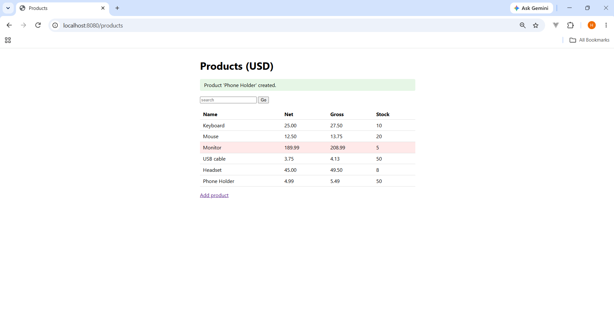
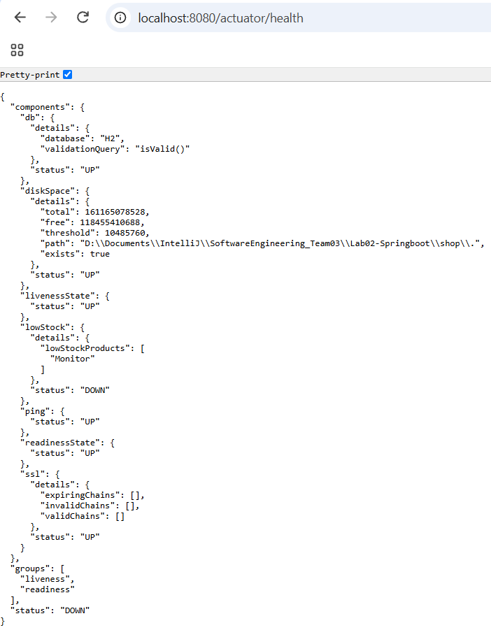

# Lab-02 · Task 5 · JSP views, profiles, Actuator, logging and an aspect

## 1. JSP views
- `pom.xml`: `<packaging>war</packaging>`, `tomcat-embed-jasper` (provided), `jakarta.servlet.jsp.jstl` (GlassFish implementation) and `jakarta.servlet.jsp.jstl-api`.
- `application.properties`: `spring.mvc.view.prefix=/WEB-INF/jsp/`, `suffix=.jsp`.
- `ProductPageController`: `GET /products`, `GET /products/new`, `POST /products`.
  Valid form -> flash message -> `redirect:/products` (POST-redirect-GET, so F5 does not re-submit).
  Invalid form -> same view again, `<form:errors>` shows the messages.
- Output is escaped with `<c:out>`; the form tags escape automatically.



## 2. Profiles and typed properties
- `application-dev.properties`: H2 console on, DEBUG for `edu.itc.se.shop` and the SQL.
- `application-prod.properties`: no console, INFO, `DB_URL` / `DB_USER` / `DB_PASSWORD` from the environment.
- `ShopProperties` is a validated record. Proof it is validated at start-up:
  Started with `--shop.tax-rate=-1`, the application refuses to start:

```
***************************
APPLICATION FAILED TO START
***************************

Description:

Binding to target edu.itc.se.shop.config.ShopProperties failed:

    Property: shop.taxRate
    Value: "-1"
    Origin: "shop.tax-rate" from property source "commandLineArgs"
    Reason: must be greater than or equal to 0.00

Action:

Update your application's configuration
```

This comes from `@Validated` and `@DecimalMin("0.00")` on `ShopProperties`, so a wrong value stops the start-up instead of causing wrong prices later.

Start-up lines, dev:
```
17:53:03.797 INFO  [none] edu.itc.se.shop.ShopApplication : The following 1 profile is active: "dev"
17:53:05.967 INFO  [none] o.s.b.h.a.H2ConsoleAutoConfiguration : H2 console available at '/h2-console'. Database available at 'jdbc:h2:mem:shopdb'
```
Start-up lines, prod:
```
18:33:04.540 INFO  [none] edu.itc.se.shop.ShopApplication : The following 1 profile is active: "prod"
18:33:06.552 INFO  [none] com.zaxxer.hikari.pool.HikariPool : HikariPool-1 - Added connection org.postgresql.jdbc.PgConnection@9119c7d
18:33:07.227 INFO  [none] o.s.boot.tomcat.TomcatWebServer : Tomcat started on port 8080 (http) with context path '/'
```

### dev vs prod

| | dev | prod |
|---|---|---|
| Database | H2 in memory (`jdbc:h2:mem:shopdb`) | PostgreSQL in Docker (`PgConnection`) |
| H2 console | `H2 console available at '/h2-console'` | no such line; `/h2-console` returns 404 |
| Notifier | `ConsoleNotifier` | `EmailNotifier` |
| Logging | DEBUG, with SQL and timing lines | INFO only |
| Credentials | none needed | `DB_URL` / `DB_USER` / `DB_PASSWORD` from the environment or `.env` (not committed) |

## 3. Actuator
- Exposed: health, info, metrics, loggers.
- `LowStockHealthIndicator` reports DOWN when a product is below `shop.low-stock-threshold`.
```
{"components":{"db":{"details":{"database":"H2","validationQuery":"isValid()"},"status":"UP"},"diskSpace":{"details":{"total":161165078528,"free":118455214080,"threshold":10485760,"path":"D:\\Documents\\IntelliJ\\SoftwareEngineering_Team03\\Lab02-Springboot\\shop\\.","exists":true},"status":"UP"},"livenessState":{"status":"UP"},"lowStock":{"details":{"lowStockProducts":["Monitor"]},"status":"DOWN"},"ping":{"status":"UP"},"readinessState":{"status":"UP"},"ssl":{"details":{"expiringChains":[],"invalidChains":[],"validChains":[]},"status":"UP"}},"groups":["liveness","readiness"],"status":"DOWN"}

{"app":{"name":"shop","description":"Lab-02 Spring shop","version":"0.0.1-SNAPSHOT"}}
```


## 4. Logging
- `RequestIdFilter` puts `requestId` in the MDC and removes it in `finally` (pool threads are reused).
- Log pattern: `%X{requestId:-none}`.
```
19:18:26.975 INFO  [68b6746a] e.itc.se.shop.service.ProductService : created product 6 'Phone Holder'

19:17:48.026 WARN  [ff118230] e.i.s.shop.web.ProductPageController : product form rejected: 3 error(s) [Field error in object 'productForm' on field 'stock': rejected value [null]; codes [NotNull.productForm.stock,NotNull.stock,NotNull.java.lang.Integer,NotNull]; arguments [org.springframework.context.support.DefaultMessageSourceResolvable: codes [productForm.stock,stock]; arguments []; default message [stock]]; default message [must not be null], Field error in object 'productForm' on field 'name': rejected value []; codes [NotBlank.productForm.name,NotBlank.name,NotBlank.java.lang.String,NotBlank]; arguments [org.springframework.context.support.DefaultMessageSourceResolvable: codes [productForm.name,name]; arguments []; default message [name]]; default message [must not be blank], Field error in object 'productForm' on field 'price': rejected value [null]; codes [NotNull.productForm.price,NotNull.price,NotNull.java.math.BigDecimal,NotNull]; arguments [org.springframework.context.support.DefaultMessageSourceResolvable: codes [productForm.price,price]; arguments []; default message [price]]; default message [must not be null]]

19:17:50.513 WARN  [0c79cd14] e.i.s.shop.web.ProductPageController : product form rejected: 2 error(s) [Field error in object 'productForm' on field 'price': rejected value [null]; codes [NotNull.productForm.price,NotNull.price,NotNull.java.math.BigDecimal,NotNull]; arguments [org.springframework.context.support.DefaultMessageSourceResolvable: codes [productForm.price,price]; arguments []; default message [price]]; default message [must not be null], Field error in object 'productForm' on field 'stock': rejected value [null]; codes [NotNull.productForm.stock,NotNull.stock,NotNull.java.lang.Integer,NotNull]; arguments [org.springframework.context.support.DefaultMessageSourceResolvable: codes [productForm.stock,stock]; arguments []; default message [stock]]; default message [must not be null]]
```

## 5. Timing aspect
`TimingAspect` is an `@Around` advice on the public methods of the `*Service` classes (DEBUG).
```
19:07:32.463 DEBUG [b55fc2e8] o.s.jdbc.core.JdbcTemplate : Executing prepared SQL statement [SELECT id, name, price, stock FROM product ORDER BY id]
19:07:32.491 DEBUG [b55fc2e8] e.itc.se.shop.service.TimingAspect : ProductService.findAll(..) took 32200 µs
19:07:32.492 DEBUG [b55fc2e8] e.itc.se.shop.service.TimingAspect : PricingService.gross(..) took 314 µs
19:07:32.492 DEBUG [b55fc2e8] e.itc.se.shop.service.TimingAspect : PricingService.gross(..) took 18 µs

curl.exe -i -X POST http://localhost:8080/actuator/loggers/edu.itc.se.shop.service.TimingAspect -H "Content-Type: application/json" -d '{\"configuredLevel\":\"OFF\"}'
HTTP/1.1 204 
X-Request-Id: 1a4832d0
Date: Sat, 31 Oct 2026 12:10:42 GMT

curl.exe http://localhost:8080/actuator/loggers/edu.itc.se.shop.service.TimingAspect
{"configuredLevel":"OFF","effectiveLevel":"OFF"}
```
After the POST, reloading `/products` printed the SQL line but no `TimingAspect` lines, and no restart was needed:
```
19:12:28.775 DEBUG [9b4630e8] o.s.jdbc.core.JdbcTemplate : Executing prepared SQL query
19:12:28.775 DEBUG [9b4630e8] o.s.jdbc.core.JdbcTemplate : Executing prepared SQL statement [SELECT id, name, price, stock FROM product ORDER BY id]
```