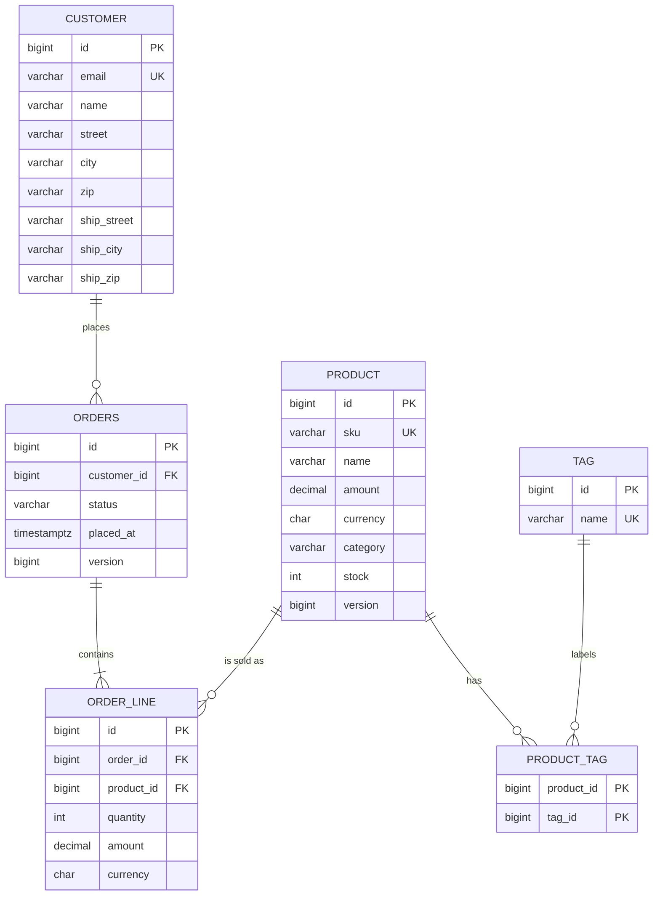

# Lab 03 – Hibernate and Spring Data JPA (`shop-jpa`)

A small shop backend (customers, products, tags, orders) built with **Spring Boot 4.1, Hibernate 7.4, Spring Data JPA 4, Flyway and H2**. It runs on **JDK 25**.

This README is the overview for the whole lab. Each task also has its own detailed file with log excerpts:
[Task 1](README-Task1.md) · [Task 2](README-Task2.md) · [Task 3](README-Task3.md) · [Task 4](README-Task4.md) · [Task 5](README-Task5.md) · [Challenge](README-Challenge.md) · [API transcript](api-session.md)

Contents:
1. [How to run](#1-how-to-run)
2. [The big picture: how JPA, Hibernate, Spring Data and Flyway fit together](#2-the-big-picture)
3. [Schema (ER diagram)](#3-schema)
4. [Task 1 – Entities and mappings](#task-1--entities-and-mappings-validated-by-flyway)
5. [Task 2 – Associations, cascading, identity](#task-2--associations-cascading-and-entity-identity)
6. [Task 3 – Repositories, queries, projections, paging](#task-3--repositories-queries-projections-and-paging)
7. [Task 4 – Entity states, transactions, locking](#task-4--entity-states-dirty-checking-transactions-and-optimistic-locking)
8. [Task 5 – N+1, batching, second migration](#task-5--n1-performance-tuning-and-a-second-migration)
9. [Challenge – reporting and bulk module](#challenge--reporting-and-bulk-module)
10. [Every repository method and its SQL](#every-repository-method-and-its-sql)
11. [What went wrong and how it was fixed](#what-went-wrong-and-how-it-was-fixed)
12. [Cheat sheet: which tool for which job](#cheat-sheet-which-tool-for-which-job)
13. [Tests](#tests)

---

## 1. How to run

There is **no database to install**. H2 runs in memory inside the application (`jdbc:h2:mem:shop`). Flyway creates the tables at every start, and the data disappears when the app stops.

```bash
./mvnw verify                                             # build + all 53 tests
./mvnw spring-boot:run                                    # empty shop on :8080
./mvnw spring-boot:run -Dspring-boot.run.profiles=dev     # with demo data (DataSeeder)
```

H2 console: http://localhost:8080/h2-console. Use JDBC URL `jdbc:h2:mem:shop`, user `sa` and an empty password.

| Endpoint | What it shows |
|---|---|
| `GET /api/orders?status=PAID&page=0&size=5&sort=placedAt,desc` | interface projection, paging (Task 3) |
| `GET /api/products?q=key&category=HARDWARE&maxPrice=60&inStock=true` | Specifications (Task 3) |
| `GET /api/customers/{email}/orders` | fetch join inside a read-only transaction (Task 3) |
| `GET /api/reports/products?category=HARDWARE&minStock=1&tag=sale&sort=amount,desc` | Criteria API report (challenge) |
| `GET /api/orders/feed?size=20&after=<placedAt>,<id>` | keyset infinite scroll (challenge) |
| `GET /api/orders/feed/slice?size=20&page=0` | the same feed with Slice / OFFSET (challenge) |

Package layout (`edu.itc.se.shop_jpa`):
```
domain/       Money, Address (embeddable records), Category, OrderStatus (enums),
              Customer, Product, Tag, Order, OrderLine (entities)
repository/   CustomerRepository, ProductRepository, OrderRepository, TagRepository, ProductSpecs,
              ProductReportRepository(+Impl), ProductReportFilter
service/      OrderService, OrderFacade, ProductService, ReportService, OrderFeedService,
              ProductReportService, StockService, StockFacade, BulkImportService, DataSeeder (@Profile("dev"))
web/          OrderController, ProductController, ReportController, ApiExceptionHandler
web/dto/      OrderSummary, ProductView, OrderDto, OrderLineDto, OrderFeed, OrderFeedItem, ProductReportRow
resources/db/migration/   V1__init.sql, V2__indexes.sql, V3__product_version.sql
```

---

## 2. The big picture

```
Controller ──► Service (@Transactional) ──► Repository (Spring Data) ──► EntityManager (JPA) ──► Hibernate ──► JDBC ──► H2
   DTOs only         business logic,          interfaces only,              the "persistence          writes the SQL
                     transaction borders      Spring writes the code        context" (1st-level cache)
```

- **JPA** (`jakarta.persistence`) is the *standard*: annotations like `@Entity` and `@OneToMany`, plus the `EntityManager` API.
- **Hibernate** is the *implementation* of that standard. It turns entity changes into SQL.
- **Spring Data JPA** generates repository classes for you from interfaces (`findByEmail`, `@Query`, paging).
- **Flyway** owns the **schema**. Versioned SQL files (`V1__…`, `V2__…`) run once, in order, and are recorded in `flyway_schema_history`. Hibernate only **validates** that schema (`ddl-auto: validate`) and never changes it.
- **Persistence context:** inside one transaction, Hibernate remembers every entity it loaded. It hands back the same Java object for the same row, and it compares each entity with its original copy at flush time ("dirty checking") to decide which UPDATEs to send.

Important settings in `application.yml`:

| Setting | Why |
|---|---|
| `ddl-auto: validate` | Flyway owns the schema. Hibernate must fail at start-up if the entities and tables disagree. `update`/`create` would hide mistakes (and cost −10 in the rubric). |
| `open-in-view: false` | The database session closes when the service transaction ends. Controllers cannot trigger lazy loading by accident. |
| `generate_statistics: true` | Lets the tests count SQL statements. |
| `jdbc.batch_size: 50`, `order_inserts`, `order_updates` | Sends INSERT/UPDATE statements in batches of 50 (Task 5). |
| `logging.level.org.hibernate.SQL: DEBUG`, `org.hibernate.orm.jdbc.bind: TRACE` | Shows every SQL statement and its parameters. Always look at the SQL! |

---

## 3. Schema



Five sequences (`customer_seq`, `product_seq`, `tag_seq`, `orders_seq`, `order_line_seq`) use `INCREMENT BY 50`.

| Migration | Content |
|---|---|
| `V1__init.sql` | 6 tables, 5 sequences, PK/FK/UNIQUE/NOT NULL, `CHECK (stock >= 0)`, `CHECK (quantity > 0)` |
| `V2__indexes.sql` | `idx_orders_customer_placed`, `idx_order_line_order`, `idx_product_category_amount` |
| `V3__product_version.sql` | `product.version` column for optimistic locking (challenge) |

**Rule:** a migration that has been applied is **never edited**. Every change gets a new version (that is why V3 exists instead of an edit to V1).

---

## Task 1 – Entities and mappings, validated by Flyway

**What was built:** `Money(amount, currency)` and `Address(street, city, zip)` are `@Embeddable` records. `Category` and `OrderStatus` are mapped with `@Enumerated(EnumType.STRING)`. The five entities use `Long` ids generated from sequences with `allocationSize = 50`. `V1__init.sql` creates the tables, and `ProductMappingTest` checks that a product survives a save/reload round-trip with its category stored as text.

### Concepts and when to use them
| Concept | What it means | When to use it |
|---|---|---|
| `@Entity` | A class with its own table and identity (an id) | Things that live on their own and change over time: Customer, Order |
| `@Embeddable` (record) | A value without its own table or id; its fields become columns of the owner | Small immutable values that only make sense inside something else: Money, Address. Records are a natural fit because values never change. |
| `@AttributeOverride` | Renames the columns of an embeddable | When the same embeddable appears twice (billing and shipping address → `ship_*` columns) |
| `EnumType.STRING` | Stores `"HARDWARE"`, not `1` | **Always.** `ORDINAL` (the default) breaks your data silently if someone reorders the enum. |
| `GenerationType.SEQUENCE` + `allocationSize = 50` | Hibernate reserves 50 ids per database round trip | The default choice. It is also required for JDBC batching (see Task 5). |
| `ddl-auto: validate` | Hibernate compares entities with the real schema at start-up | Whenever Flyway or Liquibase owns the schema, which should be always in real projects |
| Protected no-arg constructor, no `setId` | Hibernate needs a no-arg constructor; nobody else should create half-built objects or change ids | All entities |

### What to know
- `allocationSize` in Java **must equal** `INCREMENT BY` in SQL. Otherwise ids collide or Hibernate refuses to start.
- Validation runs at **start-up**, so a mapping mistake is found before any user hits it.

### The two deliberate mistakes (exact messages in [README-Task1.md](README-Task1.md))
- Column `sku` renamed to `code` in SQL only:
  `SchemaManagementException: Schema validation: missing column [sku] in table [product]`
- Sequence `INCREMENT BY 1` instead of 50:
  `MappingException: The increment size of the [product_seq] sequence is set to [50] in the entity mapping but the mapped database sequence increment size is [1]`

---

## Task 2 – Associations, cascading and entity identity

**What was built:** `Order` → `OrderLine` is a bidirectional one-to-many. `OrderLine.order` is the **owning side** (it has the foreign key `order_id`), and `Order.lines` uses `mappedBy`, `cascade = ALL` and `orphanRemoval = true`. The helpers `addLine`/`removeLine` keep both sides in sync. `Product` ↔ `Tag` is a many-to-many through `product_tag`, with `Set`s on both sides. All entities have hand-written `equals`/`hashCode`/`toString`.

### Concepts and when to use them
| Concept | What it means | When to use it |
|---|---|---|
| Owning side | The side whose field Hibernate reads to write the foreign key | Always the `@ManyToOne` side (the table with the FK). The other side says `mappedBy`. |
| `cascade = ALL` | `persist`/`remove` on the parent are passed to the children | Only for real "parts" of an aggregate (the lines belong to the order). **Never** cascade towards shared things (Customer, Product). |
| `orphanRemoval = true` | A child removed from the collection is DELETEd | When a child cannot exist without its parent (an order line without an order is garbage) |
| Helper methods (`addLine`) | Set both sides of the relation in one place | Always for bidirectional relations. Otherwise the Java objects and the database disagree. |
| `FetchType.LAZY` | The association is loaded only when touched | **Always** for `@ManyToOne` and collections. EAGER cannot be undone per query and causes hidden N+1 (−5 per EAGER in the rubric). |
| `Set` for many-to-many | No duplicates; efficient removal | `List` on `@ManyToMany` makes Hibernate delete and re-insert the whole join table on changes |

### equals / hashCode – the rule
- **equals:** same class and **same non-null id**.
- **hashCode:** a **constant per class** (`Product.class.hashCode()`).

Why a constant? A new entity has `id == null`. After `persist` the id appears. If the hashCode were based on the id, it would change, and the object would be "lost" inside a `HashSet` (`EntityIdentityTest` proves the constant works). Never use Lombok `@Data`/`@EqualsAndHashCode` on entities: they use all fields, including lazy collections.

### What went wrong (on purpose)
`toString()` that prints associations: `Order.toString()` prints `lines`, and each line prints its `order`. Outside a transaction this throws `LazyInitializationException`. Inside one, it loops forever and ends in `StackOverflowError`. **Rule:** `toString` prints scalar fields only.

SQL proof: persisting an order with 2 lines gives exactly **1 insert into orders + 2 inserts into order_line, and no update**. Removing a line gives **one `delete from order_line`**.

---

## Task 3 – Repositories, queries, projections and paging

**What was built:** four repositories with derived queries, two JPQL `@Query` methods, one native query, an interface projection (`OrderSummary`) and a record projection (`ProductView`). `ProductSpecs` provides Specifications for optional filters. There are three REST endpoints with paging and sorting, and `DataSeeder` (dev profile) adds demo data.

### Which query style when?
| Style | Example | Use it when |
|---|---|---|
| Derived query | `findByCustomerEmailAndStatusOrderByPlacedAtDesc` | Simple fixed conditions. It is checked at start-up; a typo stops the app: `No property 'emali' found for type 'Customer'`. |
| JPQL `@Query` | `select distinct o from Order o join fetch o.lines ...` | Joins, fetch joins, aggregates (`count`), or a method name that would get too long |
| Native query | `SELECT p.* FROM product p WHERE p.stock < :min` | Database-specific SQL (window functions, hints). You lose portability and type checking. |
| Specification | `ProductSpecs.filter(q, category, maxPrice, inStock)` | **Optional** filters chosen at runtime (search forms) |
| Criteria API (challenge) | `ProductReportRepositoryImpl` | Fully dynamic queries: optional joins, aggregates, sorting, projections |

### Projections: don't load what you don't need
- **Interface projection** (`OrderSummary`): Spring creates a proxy with only the getters you declare.
- **Record/DTO projection** (`ProductView`): a `select new ...ProductView(...)` constructor expression.
- **Lesson learned:** a *nested* interface projection (`CustomerName getCustomer()`) in a derived query loaded **the whole customer**. Using JPQL with aliases (`c.name as customerName`) selects only the 4 needed columns.
- A record projection in a derived query matches constructor parameters **by property name**. `amount` is not a property of `Product` (it is `price.amount`), so the query uses `@Query` with `select new`.

### Paging
`Pageable` + `@PageableDefault(size = 20, sort = "placedAt", direction = DESC)`. A `Page` runs **two** queries: the data and a `count`. `@EnableSpringDataWebSupport(pageSerializationMode = VIA_DTO)` gives the stable JSON shape `{ content, page: {size, number, totalElements, totalPages} }`.

### Rules that the rubric checks
- **No entity leaves the service layer.** Controllers return DTOs or projections.
- `@Transactional` is only on **services**, never on controllers or repositories.
- `Specification.allOf(...)` in Spring Data 4 does not accept `null`, so only the non-null specs are collected in a list first.

---

## Task 4 – Entity states, dirty checking, transactions and optimistic locking

### Entity states
```
new Product(...)   ──persist──►   MANAGED   ──transaction ends / clear()──►   DETACHED
   (transient)                  (tracked: changes                          (a normal Java object:
                                 are written automatically)                 changes are ignored)
                                       ▲                                           │
                                       └────────────── merge / save() ─────────────┘
```

| Observation | Test | Why |
|---|---|---|
| `markPaid` changes the status with **no `save()`** → exactly **1 UPDATE** | `OrderServiceTest` | Dirty checking: at commit Hibernate compares the managed entity with its snapshot |
| `findById` outside a transaction, `setStock(99)` → **nothing saved** | `ProductDetachedEntityTest` | The entity is detached at once; nobody tracks it |
| `save(detached)` → **SELECT + UPDATE** | same | `save` of an existing entity is `merge`: load the current row, copy the changes over, update |
| `@Transactional(readOnly = true)` method changes an entity → **not written** | `OrderServiceTest` | Spring sets Hibernate's flush mode to MANUAL. This is a trap: no error, the change just disappears. |
| `delete(tag)` then `save(new Tag("sale"))` → **unique-constraint violation** | `TagFlushOrderTest` | At flush Hibernate runs INSERTs **before** DELETEs. Fix: `flush()` between the two. |

### Optimistic locking (`@Version`)
Two threads load the same order (version 3) and both change it. Each UPDATE says `... where id = ? and version = 3`. The first one wins (version becomes 4). The second one updates **0 rows**, so Hibernate throws, and Spring turns that into `ObjectOptimisticLockingFailureException`. Without `@Version`, the second write would silently overwrite the first ("lost update").

**Retry must be outside the transaction.** The conflict is only detected at commit, which happens after the `@Transactional` method returns through the Spring proxy. So `OrderFacade.changeStatusWithRetry` (a *separate bean*) catches the exception and calls the service again, up to 3 times, in a brand-new transaction that reloads the fresh version. With the facade both writers succeed and the version goes up by exactly 2.

**When to use:** optimistic locking when conflicts are **rare** (most web apps). Use pessimistic locking (challenge) when conflicts are **frequent** and retries would be wasteful.

---

## Task 5 – N+1, performance tuning and a second migration

Details: [README-Task5.md](README-Task5.md).

### The N+1 problem
Load N orders with 1 query, then touch `order.getLines()` on each one: N more queries. With 50 orders that is **51 statements**, and each one is a network round trip on a real database. `NPlusOneTest` counts statements with Hibernate `Statistics` (the `QueryCounter` test helper) and fails if the count changes.

| Fix | How | Statements | Use it when |
|---|---|---:|---|
| none (naive) | `findByStatus` + `getLines()` in a loop | 51 | never in a loop |
| A. join fetch | `select distinct o from Order o join fetch o.lines ...` | 1 | One specific query needs the children. Careful: you cannot page (`LIMIT`) a collection fetch join correctly. |
| B. `@EntityGraph` | `@EntityGraph(attributePaths = {"lines", "lines.product"})` | 1 | Same, but declared on a (derived) repository method; easy to add nested paths |
| C. batch fetching | load lazy collections 16 at a time (`WHERE order_id IN (?,…)`) | 1 + ⌈50/16⌉ = 5 | As a general safety net; also works with paging |

When the **product name** is added to the report, join fetch falls back to N+1 (151 statements), because it only fetched `lines`, not `lines.product`. The entity graph stays at 1. A global `hibernate.default_batch_fetch_size=32` caps the damage (151 → 6).

### JDBC batching
With `jdbc.batch_size: 50`, saving 1 000 products took **22 prepared statements** instead of 1 000. **IDENTITY ids disable insert batching**, because Hibernate has to run each INSERT on its own to learn the generated id: the same test with IDENTITY took 1 000. That is the main reason to prefer `SEQUENCE`.

### open-in-view
With `open-in-view: false`, mapping an order to a DTO **outside** the service transaction throws `LazyInitializationException` (`OpenInViewTest`). The fix is to map to DTOs **inside** the `@Transactional` service method. Turning OSIV on would "fix" it by keeping a database connection open during the whole HTTP request, including JSON rendering, and it hides N+1 problems.

### V2 indexes and EXPLAIN
`EXPLAIN` before/after shows that `idx_product_category_amount` turns the product search from a table scan into an index scan. What else the plans show:
- The `/api/orders` query filters by `status`, which none of the indexes covers, so it stays a table scan.
- H2 already indexes foreign keys automatically, so the other two indexes change nothing on H2. On PostgreSQL they would matter.

---

## Challenge – reporting and bulk module

Details: [README-Challenge.md](README-Challenge.md).

### 1. Criteria API report: `GET /api/reports/products`
`ProductReportRepositoryImpl` is a **custom repository fragment**: `ProductRepository` extends `ProductReportRepository`, and Spring finds the implementation by the `Impl` suffix. It uses `CriteriaBuilder` directly:

- **Dynamic predicates:** `q` (name contains), `category`, `maxPrice`, `minStock`, `tag`. Each one is added only if present, and any subset works.
- **Join only when needed:** the join to `product_tag`/`tag` is only added when `tag` is given. `tagCount` uses `size(p.tags)`, which becomes a small correlated sub-select. That way it always counts *all* tags of the product, even when the result is filtered by one tag.
- **Record projection:** `cb.construct(ProductReportRow.class, sku, name, amount, stock, tagCount)` with `groupBy`.
- **Sort whitelist:** only `sku`, `name`, `amount`, `stock` and `tagCount` are accepted. `sort=version,desc` returns **400 Bad Request** (`ApiExceptionHandler`). Never put a client's text straight into ORDER BY.
- **Static metamodel:** `Product_.name`, `Money_.amount`, `Tag_.name`. These are generated at compile time by `hibernate-processor` (configured in `pom.xml`). A typo is a **compile error** instead of a runtime error, unlike `root.get("nmae")`.

```
$ curl -s "localhost:8080/api/reports/products?category=HARDWARE&minStock=1&tag=sale&sort=amount,desc"
[{"sku":"KB-7","name":"Mechanical keyboard","amount":59.00,"stock":4,"tagCount":2},
 {"sku":"KB-1","name":"Keyboard basic","amount":39.00,"stock":10,"tagCount":1}]
```
```sql
select p1_0.sku,p1_0.name,p1_0.amount,p1_0.stock,
       (select count(*) from product_tag t2_0 where p1_0.id=t2_0.product_id)
  from product p1_0
  join product_tag t1_0 on p1_0.id=t1_0.product_id join tag t1_1 on t1_1.id=t1_0.tag_id
 where lower(p1_0.name) like ? escape '' and p1_0.category=? and p1_0.amount<=? and p1_0.stock>=? and t1_1.name=?
 group by p1_0.id,p1_0.sku,p1_0.name,p1_0.amount,p1_0.stock
 order by 3 desc
```
**When to use the Criteria API:** queries whose *shape* changes at runtime (optional joins, dynamic sort, aggregates). For fixed queries, JPQL is much easier to read.

### 2. Infinite scroll: `GET /api/orders/feed`
Returns `{ items, nextCursor, hasNext }`. It is implemented twice:

**Slice (offset):** `Slice<OrderSummary> feedSlice(Pageable)`. Spring asks for `size + 1` rows to know whether there is more, and never runs a `count`:
```sql
select o1_0.id,o1_0.status,o1_0.placed_at,c1_0.name from orders o1_0 join customer c1_0 on c1_0.id=o1_0.customer_id
 order by o1_0.placed_at desc,o1_0.id desc offset ? rows fetch first ? rows only
```
**Keyset:** `Window<Order> findAllByOrderByPlacedAtDescIdDesc(ScrollPosition, Limit)`. The cursor is the last `(placedAt, id)`, e.g. `2026-11-03T23:37:23.091313Z,20`:
```sql
select ... from orders o1_0 join customer c1_0 on c1_0.id=o1_0.customer_id
 where o1_0.placed_at<? or o1_0.placed_at=? and o1_0.id<?
 order by o1_0.placed_at desc,o1_0.id desc fetch first ? rows only
```
```
$ curl -s "localhost:8080/api/orders/feed?size=20"                → {n: 20, next: "2026-11-03T23:37:23.091313Z,20", hasNext: true}
$ curl -s "localhost:8080/api/orders/feed?size=20&after=<next>"   → {n: 10, next: null, hasNext: false}
```
**Why keyset stays fast at offset 100 000:**
- `OFFSET 100000` means the database must **read and throw away** 100 000 rows before returning 20, and it gets slower with every page.
- The keyset `WHERE placed_at < ? ...` lets an index on `(placed_at, id)` **jump straight** to the right place, so every page costs about the same.
- Keyset is also stable: if a new order arrives while you scroll, offset paging shows an item twice, and keyset does not.
- The `id` is part of the sort and the cursor so that two orders with the same `placedAt` are still in a fixed order. `OrderFeedTest` creates such ties on purpose.

**When to use which:** use page numbers (`Page`) when the user needs "page 7 of 12". Use `Slice` for "load more" with shallow depth. Use keyset for infinite feeds, deep scrolling and exports.

### 3. Stock reservation that never oversells
10 threads each reserve 1 unit of a product with stock 5 (`StockReservationTest`):

| Variant | How | Result | Time |
|---|---|---|---:|
| pessimistic | `@Lock(PESSIMISTIC_WRITE)` → `select ... for update`; others **wait** | 5 ok / 5 out-of-stock, stock = 0 | 24 ms |
| optimistic | `@Version` on Product (V3) + retry in `StockFacade` | 5 ok / 5 out-of-stock after 5 retries | 31 ms |
| atomic update | `update product set stock = stock - ? where id = ? and stock >= ?` | 5 ok / 5 out-of-stock | 22 ms |

(H2 in memory on one machine, so the differences are small. On a real database with network latency the optimistic version gets clearly worse as contention grows, because every retry is a full round trip.)

**When to use which:**
- **Atomic update:** the best choice when the whole rule fits into one SQL statement ("decrement if enough"). There is no read, no lock held in Java and no retry. Note: a JPQL bulk update skips `@Version` and the persistence context, so `@Modifying(clearAutomatically = true)` clears stale entities.
- **Pessimistic lock:** for read-check-write logic that is too complex for one statement, when conflicts are frequent. Keep the transaction **short**, because other threads wait on the lock.
- **Optimistic lock:** when conflicts are rare. It needs a retry loop outside the transaction.

### 4. Bulk import of 50 000 products
`BulkImportService` reads `sku;name;amount;currency;category;stock` (`BulkImportTest`):

| Strategy | Time | Heap growth |
|---|---:|---:|
| `StatelessSession.insertMultiple` chunks of 500, `setJdbcBatchSize(500)` | **0.9 s** | ~100–160 MB |
| `saveAll` in one `@Transactional`, no clear | 1.4 s | ~250–300 MB (all 50 000 entities kept in the persistence context) |
| `saveAll` + `flush()` + `clear()` every 500 | 2.5 s | ~160 MB |

All three are under the 10 s target on H2. The heap numbers come from sampling the used heap every 5 ms, so they are only approximate.
- **StatelessSession** has no persistence context, no dirty checking and no cascades. It is perfect for imports and exports.
- **`saveAll` without clear** keeps every entity in memory, and every flush has to dirty-check all of them. With 500 000 rows it would run out of memory.
- **flush/clear** keeps memory flat in a normal session (useful when you need cascades or listeners).

---

## Every repository method and its SQL

Copied from the Hibernate log (`org.hibernate.SQL`), parameters as `?`.

| Method | SQL |
|---|---|
| `CustomerRepository.findByEmail` | `select c1_0.id,c1_0.street,c1_0.city,c1_0.zip,c1_0.email,c1_0.name,c1_0.ship_street,c1_0.ship_city,c1_0.ship_zip from customer c1_0 where c1_0.email=?` |
| `TagRepository.findByName` | `select t1_0.id,t1_0.name from tag t1_0 where t1_0.name=?` |
| `OrderRepository.findById` (inherited) | `select o1_0.id,o1_0.customer_id,o1_0.placed_at,o1_0.status,o1_0.version from orders o1_0 where o1_0.id=?` |
| `OrderRepository.findByCustomerEmailAndStatusOrderByPlacedAtDesc` | `select o1_0.id,o1_0.customer_id,o1_0.placed_at,o1_0.status,o1_0.version from orders o1_0 join customer c1_0 on c1_0.id=o1_0.customer_id where c1_0.email=? and o1_0.status=? order by o1_0.placed_at desc` |
| `OrderRepository.countByStatus` | `select count(o1_0.id) from orders o1_0 where o1_0.status=?` |
| `OrderRepository.findFirstByCustomerIdOrderByPlacedAtDesc` | `select o1_0.id,o1_0.customer_id,o1_0.placed_at,o1_0.status,o1_0.version from orders o1_0 where o1_0.customer_id=? order by o1_0.placed_at desc fetch first ? rows only` |
| `OrderRepository.findWithLinesByCustomerEmail` | `select distinct o1_0.id,o1_0.customer_id,l1_0.order_id,l1_0.id,l1_0.product_id,p1_0.id,p1_0.category,p1_0.name,p1_0.amount,p1_0.currency,p1_0.sku,p1_0.stock,p1_0.version,l1_0.quantity,l1_0.amount,l1_0.currency,o1_0.placed_at,o1_0.status,o1_0.version from orders o1_0 join order_line l1_0 on o1_0.id=l1_0.order_id join product p1_0 on p1_0.id=l1_0.product_id join customer c1_0 on c1_0.id=o1_0.customer_id where c1_0.email=? order by o1_0.placed_at desc` |
| `OrderRepository.countLinesByStatus` | `select count(ol1_0.id) from order_line ol1_0 join orders o1_0 on o1_0.id=ol1_0.order_id where o1_0.status=?` |
| `OrderRepository.findByStatus(status, pageable)` | `select o1_0.id,o1_0.status,o1_0.placed_at,c1_0.name from orders o1_0 join customer c1_0 on c1_0.id=o1_0.customer_id where o1_0.status=? order by 3 desc fetch first ? rows only` + `select count(o1_0.id) from orders o1_0 where o1_0.status=?` |
| `OrderRepository.findByStatus(status)` | `select o1_0.id,o1_0.customer_id,o1_0.placed_at,o1_0.status,o1_0.version from orders o1_0 where o1_0.status=?` |
| `OrderRepository.findByStatusWithLines` | `select distinct o1_0.id,o1_0.customer_id,l1_0.order_id,l1_0.id,l1_0.product_id,l1_0.quantity,l1_0.amount,l1_0.currency,o1_0.placed_at,o1_0.status,o1_0.version from orders o1_0 join order_line l1_0 on o1_0.id=l1_0.order_id where o1_0.status=?` |
| `OrderRepository.findWithGraphByStatus` | `select o1_0.id,o1_0.customer_id,l1_0.order_id,l1_0.id,l1_0.product_id,p1_0.id,p1_0.category,p1_0.name,p1_0.amount,p1_0.currency,p1_0.sku,p1_0.stock,p1_0.version,l1_0.quantity,l1_0.amount,l1_0.currency,o1_0.placed_at,o1_0.status,o1_0.version from orders o1_0 left join order_line l1_0 on o1_0.id=l1_0.order_id left join product p1_0 on p1_0.id=l1_0.product_id where o1_0.status=?` |
| `OrderRepository.feedSlice` | `select o1_0.id,o1_0.status,o1_0.placed_at,c1_0.name from orders o1_0 join customer c1_0 on c1_0.id=o1_0.customer_id order by o1_0.placed_at desc,o1_0.id desc offset ? rows fetch first ? rows only` |
| `OrderRepository.findAllByOrderByPlacedAtDescIdDesc` | `select o1_0.id,o1_0.customer_id,c1_0.id,c1_0.street,c1_0.city,c1_0.zip,c1_0.email,c1_0.name,c1_0.ship_street,c1_0.ship_city,c1_0.ship_zip,o1_0.placed_at,o1_0.status,o1_0.version from orders o1_0 join customer c1_0 on c1_0.id=o1_0.customer_id where o1_0.placed_at<? or o1_0.placed_at=? and o1_0.id<? order by o1_0.placed_at desc,o1_0.id desc fetch first ? rows only` |
| `ProductRepository.existsBySku` | `select p1_0.id from product p1_0 where p1_0.sku=? fetch first ? rows only` |
| `ProductRepository.findTop3ByCategoryOrderByPriceAmountDesc` | `select p1_0.id,p1_0.category,p1_0.name,p1_0.amount,p1_0.currency,p1_0.sku,p1_0.stock,p1_0.version from product p1_0 where p1_0.category=? order by p1_0.amount desc fetch first ? rows only` |
| `ProductRepository.findByTagsName` | `select p1_0.id,p1_0.category,p1_0.name,p1_0.amount,p1_0.currency,p1_0.sku,p1_0.stock,p1_0.version from product p1_0 left join product_tag t1_0 on p1_0.id=t1_0.product_id left join tag t1_1 on t1_1.id=t1_0.tag_id where t1_1.name=?` |
| `ProductRepository.findLowStock` (native) | `SELECT p.* FROM product p WHERE p.stock < ? ORDER BY p.stock` |
| `ProductRepository.findByCategory` (record projection) | `select p1_0.id,p1_0.sku,p1_0.name,p1_0.amount,p1_0.stock from product p1_0 where p1_0.category=? fetch first ? rows only` |
| `ProductRepository.findAll(Specification, Pageable)` | `select p1_0.id,p1_0.category,p1_0.name,p1_0.amount,p1_0.currency,p1_0.sku,p1_0.stock,p1_0.version from product p1_0 where lower(p1_0.name) like ? escape '' and p1_0.category=? and p1_0.amount<=? and p1_0.stock>? order by p1_0.sku offset ? rows fetch first ? rows only` |
| `ProductRepository.report` (all filters) | `select p1_0.sku c0,p1_0.name c1,p1_0.amount c2,p1_0.stock c3,(select count(*) from product_tag t2_0 where p1_0.id=t2_0.product_id) c4 from product p1_0 join product_tag t1_0 on p1_0.id=t1_0.product_id join tag t1_1 on t1_1.id=t1_0.tag_id where lower(p1_0.name) like ? escape '' and p1_0.category=? and p1_0.amount<=? and p1_0.stock>=? and t1_1.name=? group by p1_0.id,c0,c1,c2,c3 order by 3 desc` |
| `ProductRepository.report` (no filter) | `select p1_0.sku c0,p1_0.name c1,p1_0.amount c2,p1_0.stock c3,(select count(*) from product_tag t1_0 where p1_0.id=t1_0.product_id) c4 from product p1_0 group by p1_0.id,c0,c1,c2,c3 order by 1` |
| `ProductRepository.findForUpdate` | `select p1_0.id,p1_0.category,p1_0.name,p1_0.amount,p1_0.currency,p1_0.sku,p1_0.stock,p1_0.version from product p1_0 where p1_0.id=? for update` |
| `ProductRepository.decrementStock` | `update product p1_0 set stock=(p1_0.stock-cast(? as integer)) where p1_0.id=? and p1_0.stock>=?` |
| `save()` of a changed Product (dirty check) | `update product set category=?,name=?,amount=?,currency=?,sku=?,stock=?,version=? where id=? and version=?` |
| `save()` of a new entity (batched) | `select next value for product_seq` (once per 50) + `insert into product (...) values (...)` × 50 per batch |

---

## What went wrong and how it was fixed

These are the real problems met during the lab. Most are worth remembering for any JPA project.

| # | Problem | Cause | Fix |
|---|---|---|---|
| 1 | App would not start: `missing column [sku]`, `increment size ... [1]` | Entity and SQL disagreed (done on purpose in Task 1) | Keep `@Column`/`allocationSize` and the migration in sync; `validate` catches it at start-up |
| 2 | `LazyInitializationException` / `StackOverflowError` in `toString` | `toString` printed lazy associations, and the two sides printed each other | `toString` with scalar fields only |
| 3 | Nested projection loaded the whole customer | A nested interface projection in a derived query fetches the full entity | JPQL with aliases (`c.name as customerName`) |
| 4 | `ProductView` derived query failed | Record parameters are matched by property name, and `amount` is really `price.amount` | `@Query` with `select new ...ProductView(...)` |
| 5 | `Specification.allOf` with `null`s | Spring Data 4 is stricter about null arguments | Collect only the non-null specs in a list |
| 6 | `Hibernate.isInitialized(order.getLines())` always `true` | `getLines()` returns an `unmodifiableList` wrapper, not Hibernate's collection | Check with `PersistenceUnitUtil.isLoaded(order, "lines")` |
| 7 | Change silently not saved in a read-only method | `readOnly = true` sets flush mode MANUAL | Use read-only only for reads; kept as a "trap" test |
| 8 | Unique violation when replacing a tag | Hibernate runs INSERTs before DELETEs at flush | `flush()` between delete and insert |
| 9 | `@BatchSize(16)` on `Order.lines` and global `default_batch_fetch_size: 32` (as the lab says) made the "51 statements" N+1 test impossible | An entity annotation/global setting affects *every* query, including the naive one | Batch size set per transaction (`session.setFetchBatchSize(16)`); global 32 tested in its own context (`DefaultBatchFetchSizeTest`) |
| 10 | Statement counts were wrong when the whole test suite ran | All `@SpringBootTest` classes share one in-memory H2; other tests left orders behind | `TestData.clear()` before/after each test; relative counts in other tests (`before - 2` instead of `== 0`) |
| 11 | No "Executing JDBC batch" lines in the log | The batch logger is `org.hibernate.orm.jdbc.batch` in Hibernate 7, not `org.hibernate.engine.jdbc.batch` as in the lab text | Use the new logger name |
| 12 | V2 indexes did not change the `/api/orders` plan | That query filters by `status`, and H2 already indexes foreign keys | Documented with EXPLAIN; an `(status, placed_at)` index would be needed |
| 13 | Unknown sort column gave `InvalidDataAccessApiUsageException`, not `IllegalArgumentException` | Spring's repository proxy translates exceptions thrown inside a repository | `ApiExceptionHandler` maps both to **400** |
| 14 | Adding `@Version` to `Product` | The entity needs a new column, but V1 must not change | New migration `V3__product_version.sql` |
| 15 | `flyway_schema_history` query returned an extra `null` row | Flyway's first row records schema creation and has no version | Filter `where "version" is not null` |

---

## Cheat sheet: which tool for which job

| I need to… | Use |
|---|---|
| store a small value inside an entity | `@Embeddable` record |
| store an enum | `@Enumerated(EnumType.STRING)` |
| generate ids | `SEQUENCE` with `allocationSize` = `INCREMENT BY` (not IDENTITY if you want batching) |
| children that live and die with the parent | `@OneToMany(mappedBy, cascade = ALL, orphanRemoval = true)` + helper methods |
| any association | `LAZY` + fetch what you need per query |
| a simple fixed query | derived query method |
| a join / fetch join / aggregate | JPQL `@Query` |
| database-specific SQL | native query |
| optional filters | `Specification` |
| fully dynamic query, aggregates, dynamic sort | Criteria API + metamodel, as a custom fragment |
| return less data | interface or record projection |
| "page 3 of 10" | `Page` + `Pageable` |
| "load more" / infinite scroll | `Slice` (shallow) or keyset `Window` (deep, fast) |
| update without `save()` | change a managed entity inside `@Transactional` |
| prevent lost updates (rare conflicts) | `@Version` + retry in a separate bean |
| prevent overselling (frequent conflicts) | atomic `UPDATE ... WHERE stock >= ?`, or `PESSIMISTIC_WRITE` |
| avoid N+1 | join fetch / `@EntityGraph` / batch fetching |
| insert many rows | `jdbc.batch_size` + `SEQUENCE`; for huge imports `StatelessSession` |
| change the schema | a **new** Flyway migration, never edit an applied one |

---

## Tests

`./mvnw verify` → **53 tests, 0 failures** (H2 in memory, Flyway migrations, `ddl-auto=validate`; no `create-drop`).

| Task | Test classes |
|---|---|
| 1 | `ProductMappingTest`, `ShopJpaApplicationTests` |
| 2 | `OrderCascadeTest`, `EntityIdentityTest` |
| 3 | `OrderRepositoryTest` |
| 4 | `OrderServiceTest` (dirty checking, read-only trap, two-thread optimistic lock, retry), `ProductDetachedEntityTest`, `TagFlushOrderTest` |
| 5 | `NPlusOneTest`, `DefaultBatchFetchSizeTest`, `ReportTimingTest`, `BatchInsertTest`, `OpenInViewTest`, `MigrationTest` |
| Challenge | `ProductReportTest`, `OrderFeedTest`, `StockReservationTest`, `BulkImportTest` |

Test helpers: `support/QueryCounter` (counts prepared statements) and `support/TestData` (seeds and wipes order data).
